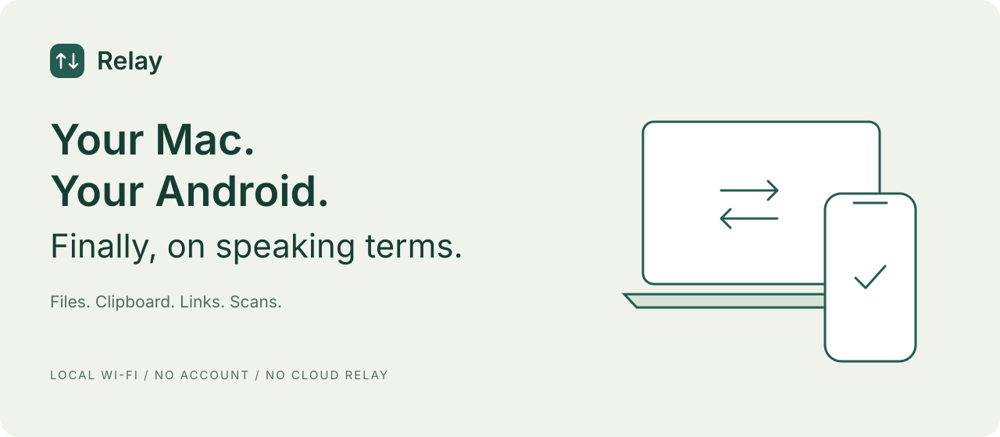

<div align="center">



**You bought a Mac. You didn't sign up to buy an iPhone.**

Relay brings your Android into your Mac workflow. Send a file, grab a clipboard,
share a link, or turn your phone into your Mac's camera and document scanner.
Your devices talk directly over local Wi-Fi.

[Download v1.4.0](https://github.com/HARSHITJAIS14/relay/releases/tag/v1.4.0) · [Get started](#get-started) · [Build from source](#build-from-source)

</div>

## Keep the phone you like

An ecosystem should connect the devices you chose. Relay is a small, native bridge
between macOS and Android, with no account and no cloud relay for your transfers.

| When you need to… | Use Relay to… |
| --- | --- |
| Get a photo or document onto the other device | Send from Android's share sheet, or choose/drop a file in the Mac window or menu bar panel. |
| Move something you copied | Sync your clipboard in the Android app or with the **Sync Clip** Quick Settings tile. |
| Reply to a message notification from your Mac | Mirror WhatsApp, Telegram, or Messages notifications and send inline replies directly from Mac. |
| Text from your computer | Browse your phone's SMS threads, view message bubbles, and compose new SMS messages from Mac. |
| Catch an incoming phone call | Live incoming call banner on Mac with contact name / caller ID and missed call notifications. |
| Save a link without losing your clipboard | Send it to the other device's text and link inbox. |
| Get a paper document onto your Mac | Capture a photo or scan multiple pages into a PDF on your phone. You can request capture from your Mac. |

## Get started

1. Install Relay on your Mac and Android phone. Put both devices on the same local network.
2. Open Relay on your Mac, then choose **Scan Mac QR code** on Android.
3. Compare the verification codes on both devices and approve pairing on your Mac.
4. Send a file, mirror notifications, browse SMS, or sync your clipboard.

Received files go to `Downloads/Relay`. Open the Mac's received-files button to jump there.
QR scanning uses Google Play services; you can also paste a pairing invitation link.

## Downloads & current status

[Download v1.4.0](https://github.com/HARSHITJAIS14/relay/releases/tag/v1.4.0), featuring SMS sync & compose, notification mirroring with inline replies, and incoming call alerts.

| Platform | Package |
| --- | --- |
| macOS (Apple Silicon) | [Relay-v1.4.0.dmg](https://github.com/HARSHITJAIS14/relay/releases/download/v1.4.0/Relay-v1.4.0.dmg) |
| Android | [Relay-v1.4.0.apk](https://github.com/HARSHITJAIS14/relay/releases/download/v1.4.0/Relay-v1.4.0.apk) |

### What's new in v1.4.0
- **SMS Companion:** Browse conversation threads from your Android phone on your Mac, view message bubble history, resolve contact names via Android Contacts, and compose & dispatch single/multipart SMS messages via your phone.
- **Notification Mirroring & Inline Replies:** Mirror message notifications (WhatsApp, Telegram, Android Messages, Slack, etc.) straight to your Mac menu bar extra with support for inline `RemoteInput` direct replies.
- **Call Companion (Stage A):** Real-time telephony callback monitoring on Android. Displays a live incoming call banner on Mac with caller ID / contact name, one-tap dismiss, and missed call notifications.
- **Tabbed Native Mac UI:** Sleek segmented navigation tabs for **Transfer**, **Messages**, and **Notifications**, with floating call alerts and live unread counts.
- **Automatic Rediscovery & Reconnection (from v1.2):** Zero-configuration mDNS / Bonjour discovery with strict mutual TLS verification. Transfers automatically resume from byte offset upon reconnection.

Relay is an early project. Current limits are part of the deal:

- **100 MiB per file.** Transfers use checkpoints and verify the complete file with SHA-256 before saving it.
- **Local network required.** Guest Wi-Fi, client isolation, firewalls, and sleeping devices can prevent connections.
- **Clipboard access depends on Android.** Use the app, share sheet, or Quick Settings tile when background clipboard access is restricted. Applying Mac clipboard updates automatically is an optional Android setting.
- **Build targets:** macOS 13+ and Android 10+. Existing device testing covers an Apple Silicon Mac and an Android 16 phone; that does not establish compatibility with every supported OS or Intel Macs.
- **Development distribution:** the Mac packaging script uses local or ad-hoc signing, and the Android build below produces a debug APK. These are not notarized Mac or Play Store releases.

## Private by design

Pairing requires explicit approval and matching verification codes. Paired devices use
mutual TLS and pinned certificate identities. The implementation permits TLS 1.2 and
TLS 1.3; transferred files are checked with SHA-256.

Relay's transfer path is device-to-device on your local network. There is no Relay account,
cloud inbox, or hosted transfer server. This is a description of the implementation,
not a claim of an independent security audit.

## Build from source

### macOS

Install Xcode Command Line Tools with a Swift 6 toolchain, then run from the repository root:

```sh
swift test --package-path apps/macos
python3 tools/package_macos.py
open apps/macos/.build/Relay.app
```

The bundle is built for the host architecture. The packaging script uses a local signing
identity if configured, or falls back to ad-hoc signing.

### Android

Install JDK 17 and Android SDK platform 36. Set `JAVA_HOME` and `ANDROID_HOME` for your installation, then:

```sh
cd apps/android
./gradlew :core:test :app:assembleDebug
```

The APK is written to `apps/android/app/build/outputs/apk/debug/app-debug.apk`.

## Where Relay goes next

The next priorities are reliable reconnect feedback, broader device testing, signed
installation packages, and a short real-device demo. Notification mirroring and remote
internet transfers are not current features.

Found a rough edge? [Open an issue](https://github.com/HARSHITJAIS14/relay/issues)
with your OS versions, what you tried, and what happened. Keep personal clipboard contents
and pairing invitations out of reports.

## License

MIT. See [LICENSE](LICENSE).
